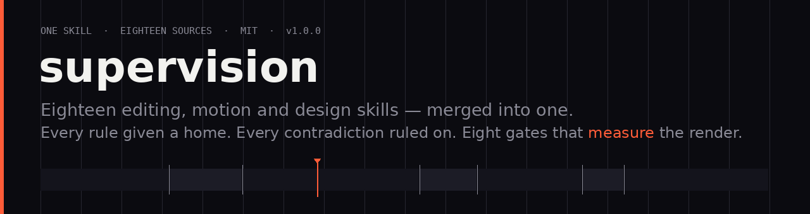

<div align="center">



# motionframe-edit

**One skill instead of eighteen.**

The best-known video editing, motion graphics and design skill repos, read rule by rule,
merged into a single agent skill — with the contradictions decided in writing, and eight
gates that measure the render before you ship it. Free, local, no API keys.

[](https://github.com/jamescai-md/motionframe-edit/actions/workflows/ci.yml)
[](LICENSE)
[](https://www.python.org)
[](#free-and-local-by-design)
[](#the-seven-skills)
[](library/)

[Quickstart](#quickstart) · [Install](#install) · [The library](#the-library--18-sources-in-one-place) · [Gates](#the-eight-gates) · [FAQ](#faq)

</div>

---

## The problem this removes

Every good editing, motion and design skill repo has one hole:

- one is excellent at cutting but needs a paid transcription API;
- one has the sharpest correctness rules but is talking-head only;
- one bans gradients, another builds everything out of them;
- one has beautiful motion doctrine and no verification;
- one has gates and a toolchain too heavy to run.

So you install eighteen, paste three into every chat, and get contradictory advice from
skills that cannot see each other. `motionframe-edit` is those eighteen **read, arbitrated and
merged** — with every rule given a home, every contradiction given a ruling, and the one
thing none of them had: a way to prove the output is correct.

## Quickstart

```bash
git clone https://github.com/jamescai-md/motionframe-edit.git
cd motionframe-edit
./install.sh                          # detects your agents, links all 7 skills
python3 tools/mfe.py doctor            # what's installed, what's missing, what's free
python3 tools/mfe.py demo --selftest   # renders a video, audits it, proves the gates can fail
```

Then ask normally:

```
"edit these takes into a 45-second Reel"     → edit-supervisor
"animate this launch film"                   → motion-director
"this landing page looks AI-made, fix it"    → design-director
"make the sheet feel right"                  → ui-motion
"is this done?" / "review it"                → gatekeeper
```

## Install

| Agent | What it reads | Install |
|---|---|---|
| **Claude Code / Claude** | `skills/<name>/SKILL.md` | `./install.sh --target claude` |
| **ChatGPT / Codex** | `AGENTS.md` | `./install.sh --target codex` |
| **Gemini CLI** | `GEMINI.md` + extension manifest | `gemini extensions link .` |
| **Antigravity** | `AGENTS.md` | `./install.sh --target antigravity` |
| **OpenCode** | `AGENTS.md` + `opencode.json` | `./install.sh --target opencode` |
| **Hermes / Cursor / Windsurf / Zed / Aider** | `AGENTS.md` | `./install.sh --dir <your skills dir>` |

One source of truth (`AGENTS.md` + `skills/`), thin adapters per platform, so they cannot
drift apart. Details: [docs/platforms.md](docs/platforms.md).

## The seven skills

| Skill | Use it when | Carries |
|---|---|---|
| **[motionframe-edit](skills/motionframe-edit/SKILL.md)** | always — it routes | twelve laws, the precedence ladder, the two STOP gates |
| **[edit-supervisor](skills/edit-supervisor/SKILL.md)** | you have footage and want a finished piece | audio-first cutting, captions, grade, mix, delivery package |
| **[motion-director](skills/motion-director/SKILL.md)** | anything moves | the designer's role, beat sheets, timing, transitions, three lanes |
| **[design-director](skills/design-director/SKILL.md)** | pages, UIs, posters, decks, brands | kind-of-business logic, systems and tokens, anti-slop |
| **[ui-motion](skills/ui-motion/SKILL.md)** | interface animation feels off | should-it-animate, springs, choreography, frame budget |
| **[gatekeeper](skills/gatekeeper/SKILL.md)** | before anything is called done | eight measured gates, the fix order, the critic brief |
| **[taste-memory](skills/taste-memory/SKILL.md)** | you're tired of repeating yourself | corrections become durable rules |

## The forks — literal, on your account

Seventeen of the eighteen sources are **real GitHub forks** on `jamescai-md`, each pinned into
this repository as a git submodule under `forks/`:

```bash
git clone --recurse-submodules https://github.com/jamescai-md/motionframe-edit.git   # full tree
git clone https://github.com/jamescai-md/motionframe-edit.git                        # lean, install-ready
```

Eight remain pending on GitHub's per-account fork throttle (`403 was submitted too quickly`);
`tools/forks.py --pending` lists them and `tools/forks.py` pins each one as soon as it exists.
[The fork network, in full →](docs/forks.md)

## The library — 18 sources in one place

`library/` is the part that makes this a merge rather than a summary. **One digest per
source**, and in each: what it is, the rules worth keeping, what it gets wrong, and exactly
where each kept rule landed.

```
library/
├── editing/   i-hate-editing · video-use · freecut · herk-edit-kit · video-short ·
│             tiktok-short-edit · open-edit · hypit
├── motion/    motionmaxxing · motion-kit · reelmimic · hyperframes ·
│             hyperframes-launches · remotion
└── design/    taste-skill · ui-ux-pro-max · emil-skills · apple-design
```

The skills point into the library and load only what the job needs — a captioning task does
not pull in the design system. Two sources (`open-edit`, `hypit`) are applications rather
than doctrine: read, credited, deliberately not merged. Five cannot be redistributed (no
licence file, or `NOASSERTION`); their ideas are summarised, never their text.

Per-source credit, licences and corrections: [ATTRIBUTION.md](ATTRIBUTION.md).
Which rule came from where: [docs/absorption.md](docs/absorption.md).

## The eight gates

Every render is measured against the same eight checks. A gate that cannot fail is
decoration, so `mfe.py demo --selftest` feeds them deliberately broken renders — frozen
picture, silent file, wrong aspect, unsafe captions, fabricated screenshot — and **fails the
build if they do not catch them**.

| Gate | Name | Passes when |
|---|---|---|
| **G0** | render exists | decodes, moves, duration within 1% of plan, audio present |
| **G1** | delivery shape | exact dimensions, fps, codec, container for the destination |
| **G2** | loudness | within ±2 LU of target, true peak ≤ −1 dBTP |
| **G3** | picture alive | no freeze > 0.5 s, no stillness > 3 s |
| **G4** | no black holes | no unintended black interval |
| **G5** | cuts don't pop | no boundary spike > 6 dB over the local body level |
| **G6** | captions safe | every cue inside the platform safe zone |
| **G7** | honest proof | every asset declares an origin; nothing generated claims to be real |

Full definitions: [specs/gates.json](specs/gates.json).

## Free and local by design

No API keys, no accounts, no credits, no telemetry. Nothing leaves the machine.

| Job | Free tool | The paid API you do not need |
|---|---|---|
| transcode, cut, composite, grade | `ffmpeg` | any cloud render farm |
| transcription | `whisper.cpp` / `faster-whisper` | cloud ASR |
| captions | `libass` (in ffmpeg) | caption SaaS |
| motion graphics | HTML + GSAP + headless Chrome (free), or Remotion (own licence) | motion SaaS |
| loudness | `loudnorm` / `ebur128` | mastering service |

`mfe.py doctor` names what is missing and the free command to install it. A lint rule fails
the build if a paid-API pattern ever appears in this repository.

## Verified, not asserted

```
  gate report  ·  the repository itself
  PASS  D0  first screen · D1 links · D2 frontmatter · D3 generated ·
  PASS  D4  placeholders · D5 honesty · D6 provenance
  verdict: PASS
```

`tools/gate-docs.py` measures this repository the way `gatekeeper` measures a render, and
`--selftest` proves each check can fail. CI runs it alongside the engine tests on Python
3.10/3.12/3.13, a clean-machine installer check, and the end-to-end self-audit.

## FAQ

**Is this a fork?**
No. Nothing here is vendored or copied. Eighteen sources were read, and their doctrine was
rewritten with every rule traced. Five could not be legally redistributed, which is one of
several reasons a fork would have been the wrong shape.

**Do I need eighteen repos installed?**
No — that is the point. One clone, one install, seven skills, and a library the skills read
on demand.

**Does it work with ChatGPT?**
Yes: `AGENTS.md` is the entry point for ChatGPT/Codex and any tool that reads that
convention. [docs/platforms.md](docs/platforms.md) covers each of the six.

**Is my footage uploaded anywhere?**
No. There is no network code in the engine.

**Can I use it commercially?**
MIT for this repository. One optional motion lane (Remotion) has its own licence and is
**not** free for companies — the lane table says so, and nothing else depends on it.

**What is the biggest known gap?**
Renders are validated against a synthetic fixture, not real footage. That is stated here
rather than buried, and it is the first item on the plan.

## Licence

MIT © motionframe-edit contributors. See [LICENSE](LICENSE).
